# FSA — Веб-приложение для анализа бухгалтерской отчетности

<p align="center">
  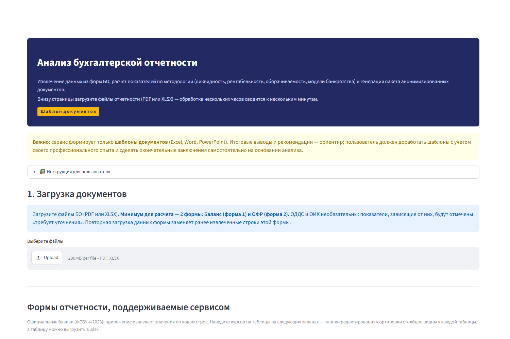
</p>

**FSA (Financial Statement Analysis)** — Streamlit-приложение, которое автоматизирует анализ бухгалтерской (финансовой) отчетности российских организаций по формам ФСБУ 4/2023: извлекает данные из PDF и XLSX, проверяет их по контрольным формулам, рассчитывает весь набор финансовых показателей по методологии и формирует пакет анонимизированных аналитических документов.

Ручная обработка отчетности (перенос цифр из PDF в Excel, расчеты, написание заключения) занимает несколько часов. Приложение сводит процесс к нескольким минутам: загрузка → проверка → готовый пакет документов.

**🔗 Онлайн-демо (Streamlit Community Cloud):** https://fsa-gnyuri-lab.streamlit.app/

## Возможности

- **Извлечение данных** из всех 4 форм отчетности (Баланс, ОФР, ОДДС, ОИК) из текстовых PDF, XLSX и PDF-сканов (OCR Tesseract, 600 dpi).
- **Верификация данных** — редактируемые таблицы извлеченных строк и сверка по контрольным формулам форм (устойчивость к ошибкам распознавания).
- **Расчетный движок по методологии анализа**: 6 разделов — основные показатели, ликвидность и платежеспособность, деловая активность (оборачиваемость), рентабельность и эффективность, структура капитала и долговая нагрузка, риски банкротства (Z-счет Альтмана, модель Таффлера).
- **Аналитическая панель**: карточки ключевых KPI, статусы показателей относительно рекомендуемых диапазонов (🟢/🔴), горизонтальный анализ по годам.
- **Визуализация** (Altair): структура активов и капитала (круговые), динамика статей Баланса, финансовые результаты, приросты по годам (гистограммы).
- **Генерация пакета документов**: `explonation.xlsx` (исходные данные, расчеты с формулами текстом, диаграммы), `rezult.docx` (аналитическое заключение), `presentation.pptx` (презентация с выводами и графиками).
- **Анонимизация (BR-03)**: автоматическое удаление названий компаний, ИНН, ФИО и должностей из всех выходных файлов.
- **Адаптивный интерфейс**: работает на экранах от 360 px; недостающие данные помечаются «требует уточнения», ошибки ОДДС/ОИК не блокируют расчет.

## Скриншоты

| Экран 1. Загрузка документов | Экран 2. Верификация данных |
| :---: | :---: |
| 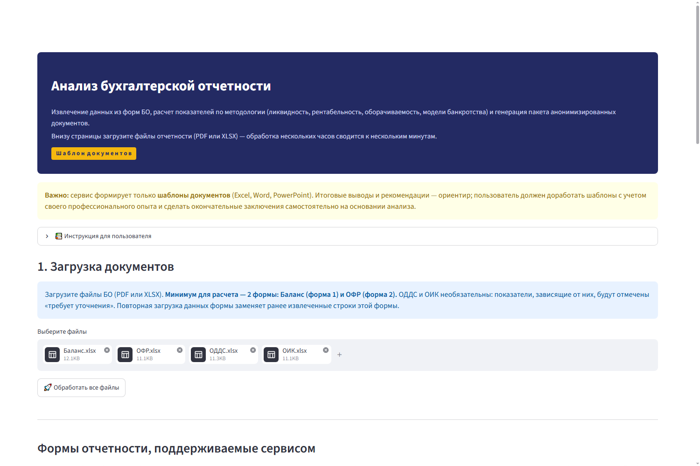 | 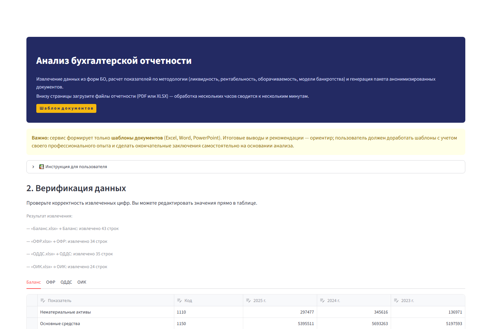 |

| Проверка контрольных сумм | Экран 3. Данные по амортизации (EBITDA) |
| :---: | :---: |
| 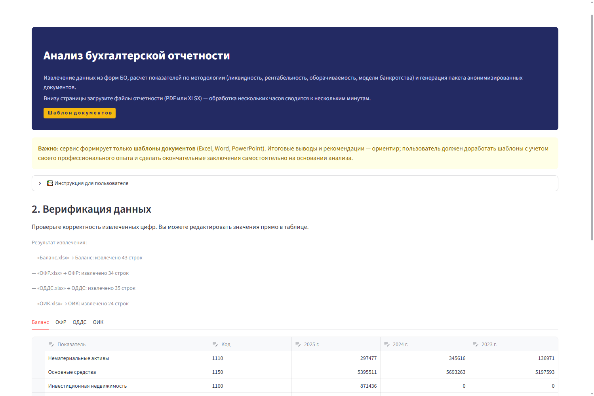 | 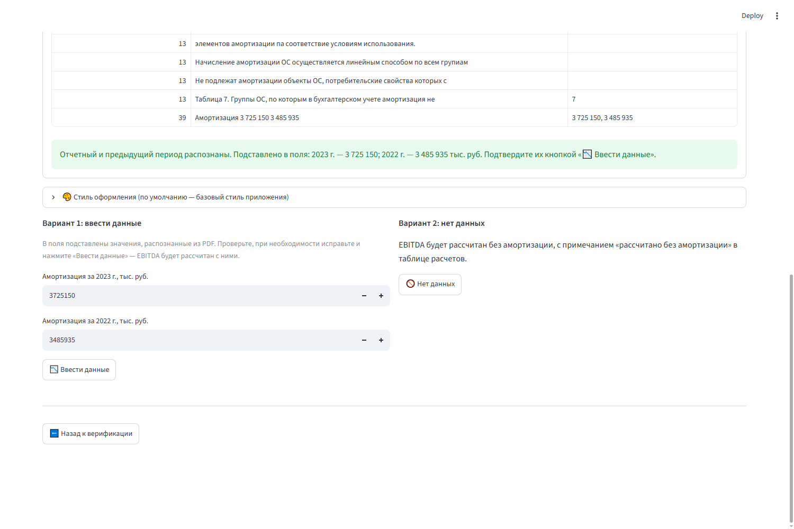 |

| Экран 4. Основные показатели | Горизонтальный анализ |
| :---: | :---: |
| 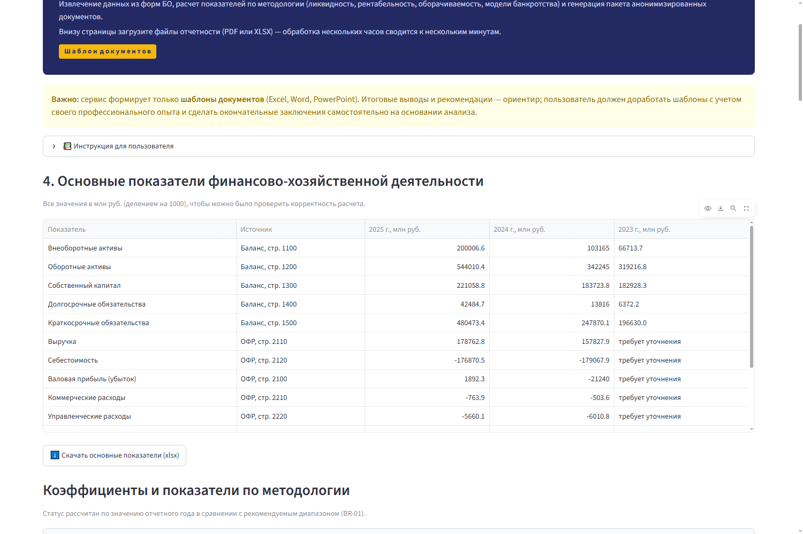 | 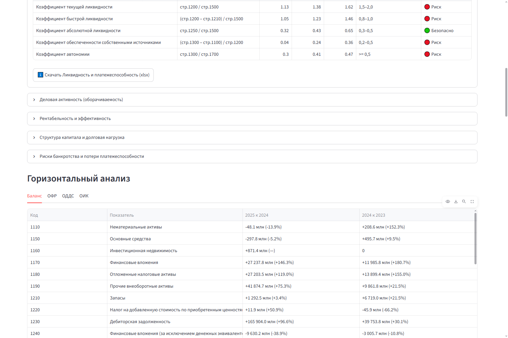 |

| Аналитическая панель (Visualization) | Диаграммы (Ликвидность и др.) |
| :---: | :---: |
| 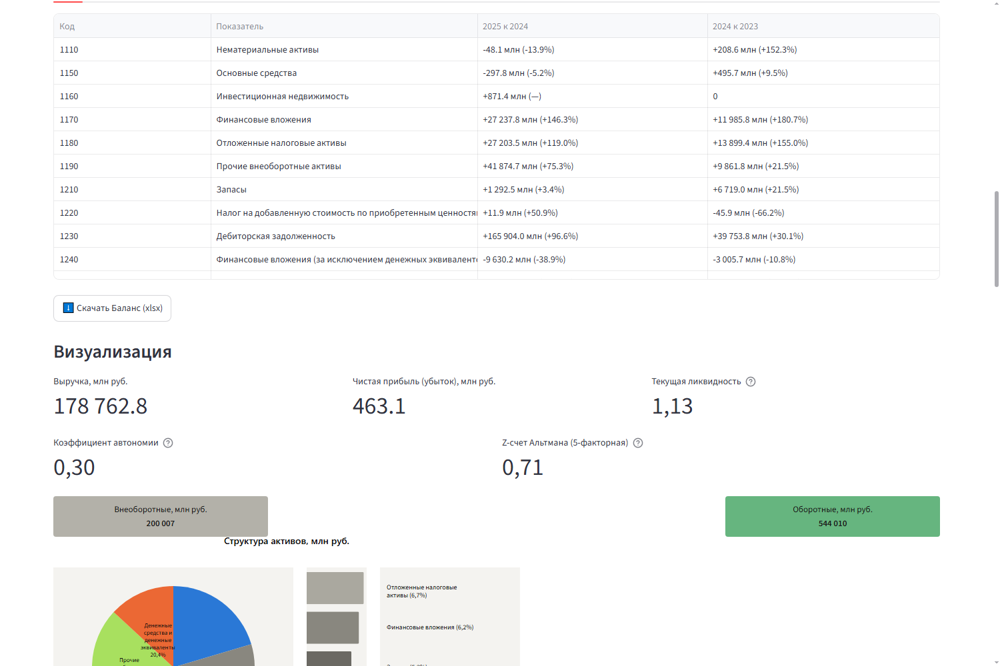 | 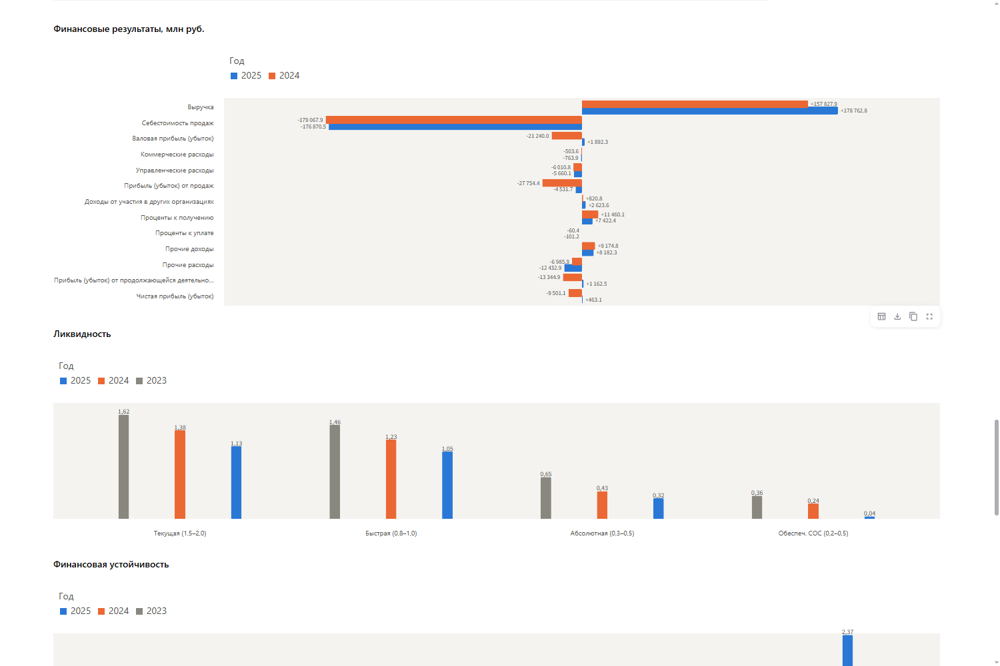 |

| Экран 5. Генерация пакета отчетов | Пакет сформирован |
| :---: | :---: |
| 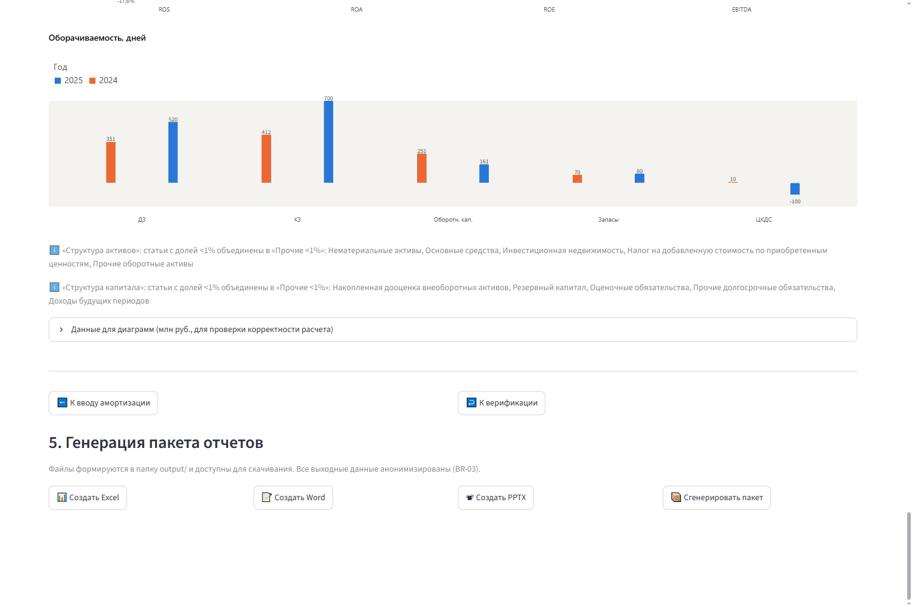 | 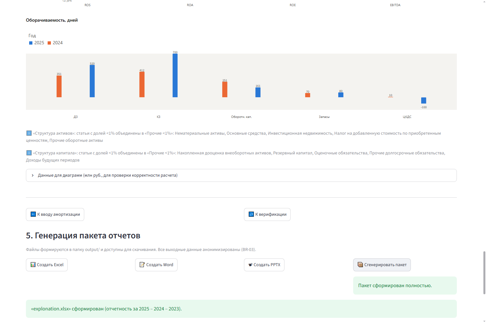 |

## Структура проекта

```
FSA/
├── README.md                    — этот файл
├── ТЗ_MVP.md                    — техническое задание на MVP (полный документ)
├── requirements.txt             — зависимости Python
├── src/                         — исходный код приложения
│   ├── app.py                   — Streamlit-интерфейс (мастер из 5 шагов)
│   ├── data_extraction.py       — извлечение данных: pdfplumber, OCR (Tesseract), openpyxl
│   ├── analytics.py             — расчетный движок: KPI, Z-счета, верификация формул
│   ├── charts.py                — визуализация на Altair (стиль, палитра)
│   ├── report_gen.py            — генерация .xlsx / .docx / .pptx + проверка анонимизации
│   └── extract_amortization.py  — поиск амортизации в пояснениях к отчетности
├── .claude/
│   └── skills/fsa-repo/         — скилл для Claude Code: правила работы с репозиторием (структура, запуск, проверки, публикация)
├── forms/                       — официальные бланки форм ФСБУ 4/2023 (XLSX) и их скриншоты
└── docs/
    └── screenshots/             — скриншоты экранов приложения (для README)
```

> Папки `input/`, `output/`, `test_data/`, `reference/` содержат примеры отчетности и готовые документы и в репозиторий **не включаются** — они добавляются пользователем при работе с приложением.

## Требования

- Python 3.11+
- [Tesseract OCR](https://github.com/tesseract-ocr/tesseract) — только для PDF-сканов:
  - Windows: скачайте установщик [tesseract-ocr-w64-setup](https://github.com/UB-Mannheim/tesseract/wiki), добавьте папку `Tesseract-OCR` в PATH;
  - установите русский и английский языковые пакеты (`rus`, `eng`).
- Microsoft Office (Word, Excel, PowerPoint) — используется при генерации документов (через `pywin32`, COM-интерфейс) на Windows.

## Установка и запуск

```bash
# 1. Клонировать репозиторий
git clone https://github.com/gnyuri-lab/fsa.git
cd fsa

# 2. (Рекомендуется) создать виртуальное окружение
python -m venv .venv
.venv\Scripts\activate          # Windows
# source .venv/bin/activate     # Linux / macOS

# 3. Установить зависимости
pip install -r requirements.txt

# 4. Запустить приложение
streamlit run src/app.py
```

Приложение откроется в браузере по адресу **http://localhost:8501**.

### Развертывание в облаке (Streamlit Community Cloud)

Приложение также развернуто в бесплатном облаке: **https://fsa-gnyuri-lab.streamlit.app/** (деплой из этого репозитория). Чтобы развернуть свою копию: https://share.streamlit.io → Sign in (через GitHub) → **Create app** → указать репозиторий `gnyuri-lab/fsa`, ветку `main`, главный файл `src/app.py` → **Deploy**. Ограничения облачной версии: уходит в спящий режим после 12 часов без трафика (просыпается по клику), файлы между сессиями не сохраняются; `pywin32`-вставка диаграмм Word как OLE-объектов недоступна — заключение формируется с PNG-графиками (автоматически). Пакеты `packages.txt` включают Tesseract OCR — сканы PDF распознаются и в облаке.

## Как пользоваться

Приложение — мастер из 5 шагов:

1. **Загрузка документов.** Загрузите файлы отчетности (PDF или XLSX) — минимум 2 формы: **Баланс (форма 1)** и **ОФР (форма 2)**. ОДДС и ОИК необязательны (недостающие показатели будут помечены «требует уточнения»). Нажмите «🚀 Обработать все файлы». Отчетность можно скачать через бесплатный государственный ИР БФО (ФНС) — ссылка на сервис есть внизу страницы.

2. **Верификация данных.** Проверьте извлеченные строки на 4 вкладках (Баланс, ОФР, ОДДС, ОИК) — значения можно редактировать прямо в таблице и выгружать в .xlsx. Нажмите «🔍 Проверить данные» — сверка по контрольным формулам форм. Форму с ошибками можно исключить из расчета кнопкой «Рассчитать без…» и вернуть обратно. Затем «✅ Подтвердить и приступить к расчету».

3. **Амортизация (EBITDA).** Введите амортизацию за отчетный и предыдущий годы (тыс. руб.) или выберите «🚫 Нет данных» — тогда EBITDA будет рассчитан без амортизации с соответствующей пометкой.

4. **Основные показатели.** Аналитическая панель: таблица основных показателей (млн руб.), коэффициенты по 6 разделам методологии со статусами (🟢 норма / 🔴 риск), горизонтальный анализ по годам, визуализация (круговые диаграммы структуры активов/капитала, динамика статей, финансовые результаты, ликвидность, устойчивость, рентабельность, оборачиваемость). Все таблицы скачиваются в .xlsx.

5. **Генерация пакета отчетов.** Кнопки «📊 Создать Excel», «📝 Создать Word», «📽 Создать PPTX» или «📦 Сгенерировать пакет». Файлы формируются в папку `output/` и доступны для скачивания в интерфейсе:
   - `explonation.xlsx` — исходные данные и все расчеты (показатель, формула текстом, значение, рекомендуемый диапазон), диаграммы;
   - `rezult.docx` — итоговое заключение с выводами, рекомендациями, таблицами и диаграммами;
   - `presentation.pptx` — презентация с ключевыми выводами и графиками.

> ⚠️ **Важно:** сервис формирует только **шаблоны документов**. Итоговые выводы и рекомендации — ориентир; окончательное заключение пользователь делает самостоятельно на основании анализа и своего профессионального опыта.

## Анонимизация и конфиденциальность

- Все выходные документы **автоматически анонимизируются**: названия компаний, ИНН, ФИО и должности не попадают в файлы (проверка `verify_anonymity` встроена в генератор).
- Файлы отчетности обрабатываются **локально**: загрузка PDF и XLSX не требует внешних сервисов, данные никуда не отправляются.
- Точка доверия: приложение лишь помогает подготовить анализ, ответственность за итоговые выводы остается за аналитиком.

## Технологии

| Слой | Инструменты |
| :--- | :--- |
| Интерфейс | Streamlit, адаптивная верстка (от 360 px) |
| Извлечение | pdfplumber (текстовые PDF), Tesseract OCR (сканы, 600 dpi), openpyxl/pandas (XLSX) |
| Расчеты | Pandas (KPI, Z-счет Альтмана, Таффлер, контрольные формулы форм) |
| Визуализация | Altair (панель), matplotlib (диаграммы в документах) |
| Документы | python-docx, openpyxl, python-pptx |

---

Развитие проекта описано в [ТЗ_MVP.md](ТЗ_MVP.md).

## Лицензия

Проект распространяется по лицензии [MIT](LICENSE) — код можно свободно использовать, изменять и распространять, в том числе в коммерческих целях, с сохранением уведомления об авторских правах.